# CCSA105 – Policy Layers Lab Report

**Name:** Haruna Hamidu
**Student ID:** C11-2026-CCSA-17060
**Course:** Check Point Certified Security Administrator (CCSA)
**Topic:** Policy Layers (Ordered Layers and Inline Layers) in SmartConsole and the Gaia Portal

---

## 1. Introduction

This report covers my full assignment on Check Point policy layers. I did the practical work in **SmartConsole** and the **Gaia Portal**. I started by finding the default policy and its layer, then built my own policy package (`Orion Layers`) with two Ordered Layers and an Inline Layer. After that I installed it, tested it with real traffic and fixed what broke.

The big idea I took from this lab: a connection can be **accepted** in one layer and still be **dropped** in the next. A layer only decides for itself. The packet has to be allowed by every layer.

---

## Part A – Practical Lab

### Task 1 – Exploring the default policy

**1a. Default Access Control policy and Ordered Layer**
In SmartConsole I opened *Manage policies and layers* and found what the default setup is:

| Item | Value |
|---|---|
| Default Access Control policy | **Standard** |
| Default Ordered Layer | **Network** |

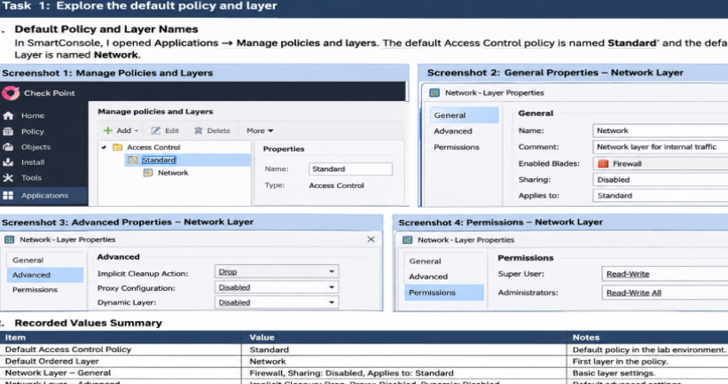

**1b. Properties of the default Network layer**

- **General:** This page shows the basic details of the layer, such as the blades enabled, sharing status and where the layer is used. The Firewall blade is enabled, Sharing is disabled, and the layer is used in the Standard policy.
- **Advanced:** This is where unmatched traffic is handled. The **Implicit Cleanup Action is Drop**, so anything that matches no rule is blocked. Proxy Configuration and Dynamic Layer are both disabled.
- **Permissions:** This controls who can edit the layer. From the lab handout and what I saw, the Super User profile has Read/Write and Administrators have Read/Write All, so both can change the layer.

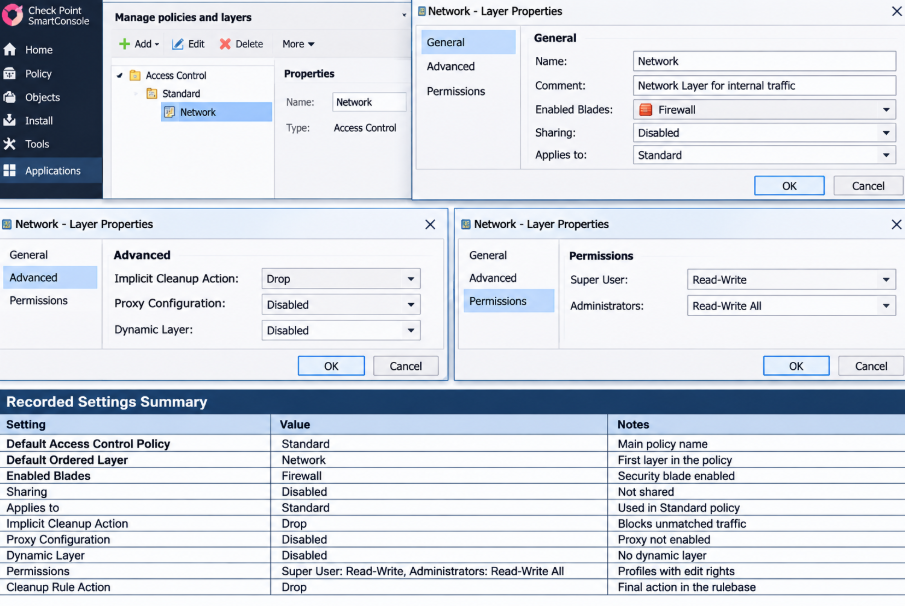

**1c. Cleanup Rule action**
I opened the rulebase of the default policy and looked at the bottom. The Cleanup Rule action is **Drop**, with logging enabled so an admin can review what got dropped.

*Evidence:* I could not take a screenshot for this one because of a technical problem in my organisation (the system was down at the time). The observation above is what I recorded while working through the lab.

---

### Task 2 – Create a policy package and build the Network layer

I created a new policy package called **Orion Layers** with Access Control turned on and the **Network** layer selected.

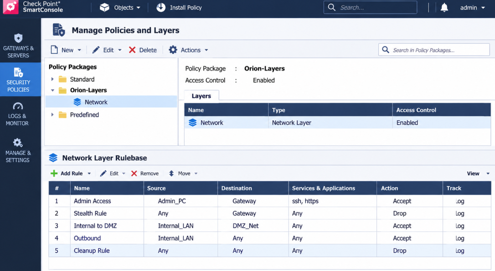

The Network layer rulebase has **five rules**. For each one I filled in the source, destination, service, action and logging. Rule 3 is the **Internal to DMZ** rule, which is an Accept rule (it becomes important later in Task 5).

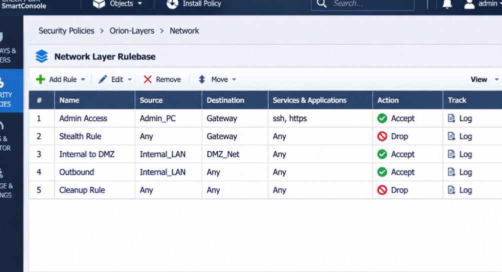

The Cleanup Rule is set explicitly to **Drop**, which matches the layer's implicit cleanup action.

---

### Task 3 – Add a second Ordered Layer

I added a second Ordered Layer called **Service-Control** to the Orion Layers package and went through its settings:

- 3a. General settings

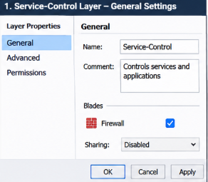
- 3b. Advanced settings

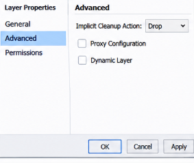
- 3c. Permissions settings

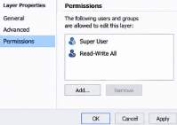
- 3d. The Orion Layers policy showing both layers

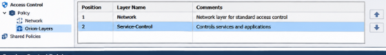
- 3e. The Service-Control rulebase

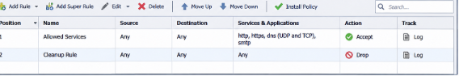

---

### Task 4 – Install, test and fix

- **4a.** Installed the Orion Layers policy successfully.

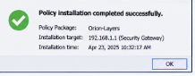
- **4b. T1 – SSH before the fix:** The SSH connection was **dropped**.

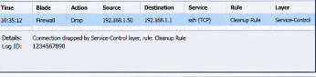
- **4c. The fix:** I added an **Admin Services** rule to the Service-Control layer so admin traffic like SSH is allowed.

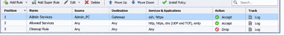
- **4d. T1 – SSH after the fix:** SSH is now **accepted**.

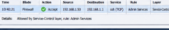
- **4e. HTTP:** Accepted.

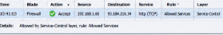
- **4f. Ping / ICMP:** Dropped by the Cleanup Rule of the Service-Control layer.

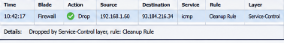
- **4g. Ping:** Dropped by the Stealth Rule of the Network layer.

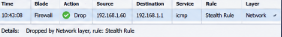
- **4h. Telnet:** Dropped by the Service-Control Cleanup Rule.

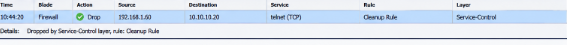

SSH is the one that taught me the most. It was dropped because Service-Control did not have an allow rule for it, so the traffic never made it through. I checked the logs to see which layer was responsible, then added the rule in the right place.

---

### Task 5 – Create an Inline Layer

I created an Inline Layer called **DMZ-Policy**.

- **5a. General:** Three blades enabled, Mobile Access disabled, Sharing enabled.

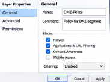
- **5b. Advanced:** Implicit Cleanup Action is **Drop**.

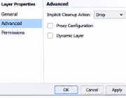
- **5c. Permissions:** Super User and Read-Write All.

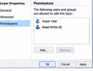
- **5d. Rulebase:** Three rules: **Web Access**, **Mail Access** and a **Cleanup Rule**.
  *(No screenshot of the DMZ-Policy page, because my system got stuck while I was working on it.)*
- **5e. Network layer, Rule 3:** I changed the Internal to DMZ rule so its action is **Inline Layer** and assigned it **DMZ-Policy**.

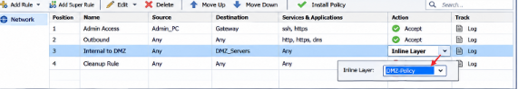

---

### Task 6 – Install and verify the Inline Layer

I installed the policy again and ran these tests:

**6a. T6 – HTTP access to Web_Server**

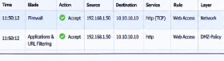

**6b. T7 – SMTP access to Mail_Server**

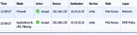

**6c. T8 – Telnet to Web Server (dropped)**

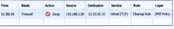

**6d. T9 – HTTP access to an external server**

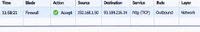

**Before vs after the Inline Layer (Telnet)**

- **T5 – before:** The Network layer's Internal to DMZ rule accepted Telnet, but the **Service-Control Cleanup Rule** dropped it because Telnet was not an allowed service.
- **T8 – after:** The Internal to DMZ rule now calls DMZ-Policy. Telnet reaches the Inline Layer and is dropped by the **DMZ-Policy Cleanup Rule**.

**Conclusion:** Both tests end in a Drop, but the rule doing the dropping changed from the Service-Control Cleanup Rule to the DMZ-Policy Cleanup Rule. The reason is that the Inline Layer now controls traffic entering the DMZ.

---

### Task 7 – Layer order and sharing

- **7a.** I changed the layer order (moving Service-Control above Network) and then restored the original order.

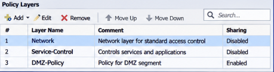
- **7b. T3 and T4 evidence:** I could not provide screenshots for this part.

**Explanation:** When Service-Control is above Network, it evaluates traffic first. ICMP is not in the Allowed Services, so the Service-Control Cleanup Rule drops both T3 and T4 before Network even sees them. The user sees no difference because the traffic is blocked either way. Only the layer responsible for the drop changes.One more detail I want to keep straight: **DMZ-Policy is an Inline Layer attached to Network rule 3, not a third Ordered Layer.**

---

## Part B – Questions

### B1. Objective questions

| Q | Answer |
|---|---|
| 1 | b |
| 2 | a |
| 3 | a |
| 4 | d |
| 5 | b |

### B2. Short theory answers

**1. What is a policy layer?**
A policy layer is an individual set of Access Control rules that forms part of a larger security policy.

**2. What are Ordered Layers?**
Ordered Layers are placed in a defined sequence inside the Access Control policy. Traffic is checked against them in that order.

**3. How does the gateway evaluate Ordered Layers?**
From top to bottom. If a packet matches a Drop rule, it is denied and evaluation stops. If it matches an Accept rule, it moves on to the next Ordered Layer, so it is not finally accepted until the remaining layers have permitted it too. If no rule matches in a layer, that layer's Implicit Cleanup Action decides.

**4. What are the three groups of layer properties?**
- **General:** layer name, enabled blades, Sharing setting.
- **Advanced:** Implicit Cleanup Action, Proxy Configuration, Dynamic Layer.
- **Permissions:** which permission profiles can edit the layer.

**5. What does Sharing do?**
Sharing controls whether a layer can be reused by other policy packages. When it is enabled, the layer can be selected in another package in the same management environment. A sensible rule is to share a layer when the same rules really need to be maintained centrally across packages. Because one change can affect several policies, I would test and review before installing.

### B3. Scenario questions

**Scenario 1 – Accepted in the first layer, dropped in the second**
The connection is dropped by the **second layer**. The Accept in the first layer only lets the connection continue through the policy; it does not override the second layer.

To confirm it, I would generate the connection, open **Logs & Monitor**, filter by source, destination and service, and check that the final action is Drop from the second layer's cleanup decision.

If the connection should be allowed, I would add a specific Accept rule in the second layer, **above** its cleanup rule, limited to the required source, destination and service. Then I would publish and install the policy.

I recommend an **explicit Cleanup rule** because it makes the final deny visible in the rulebase, easier to audit and easier to spot in the logs.

**Scenario 2 – Designing a layered policy**
I would split the policy by enforcement responsibility:

- **Network layer:** administrator access, gateway protection, internal network access and routing-related traffic.
- **Service-Control layer:** only approved application services such as HTTP, HTTPS, DNS and SMTP.
- **Inline Layer:** attached to the rule that sends traffic to the DMZ, with specific rules for the web and mail servers plus a cleanup rule.

This is easier to understand because every layer has one clear job. Permission profiles let the network team edit network rules and the DMZ team edit only the DMZ layer, which cuts down accidental changes. One honest point: Inline and Ordered Layers do **not** automatically make packet processing faster. The main benefit is organisation and controlled enforcement. Performance should still be checked in the real environment, and rules should be kept efficient with no unnecessary duplication.

---

## Conclusion

This lab showed me how Check Point layers work together. The things I will remember:

1. Layers are checked in order, and **every layer has to allow the traffic**.
2. An Accept in one layer is not the end of the story.
3. Logs tell you which layer and which rule made the decision, so use them when troubleshooting.
4. An Inline Layer is a layer inside a rule, not another Ordered Layer.
5. Layers are mainly for organisation and control, not for speed.
